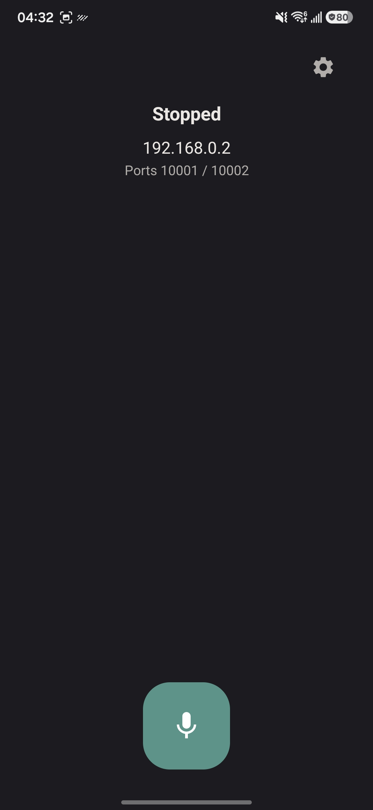
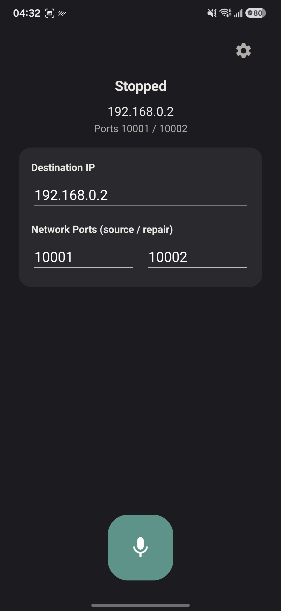
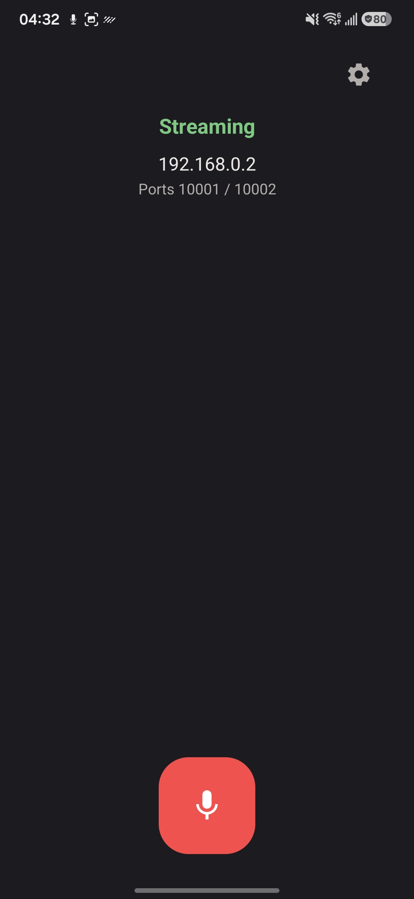

# Roclet

<p align="center">
  
</p>

Roclet turns an Android phone into a wireless microphone for a
[Roc Toolkit](https://roc-streaming.org) receiver over Wi-Fi.

[Source](https://github.com/Speyll/Roclet) · [Issues](https://github.com/Speyll/Roclet/issues) · [Releases](https://github.com/Speyll/Roclet/releases)

## Screenshots

<p align="center">
  
  
  
</p>

## How it works

Roclet sends the phone's microphone as a Roc `rtp+rs8m` source stream, with a
separate `rs8m` repair stream. On the receiver it appears as a normal audio
source. The default ports are `10001` for source and `10002` for repair.

## Requirements

- Android 10 (API 29) or newer on an `arm64-v8a` device.
- A Wi-Fi network shared with the receiver.
- A Roc Toolkit receiver, such as `roc-recv` or the PipeWire/PulseAudio Roc
  module.

## Setup

Start the receiver on the same network, then install Roclet from the
[releases page](https://github.com/Speyll/Roclet/releases). Open the app, enter
the receiver's address and ports, and tap the microphone button. Release builds
are signed; uninstall a debug build before installing a release build.

See the [Roc Toolkit documentation](https://roc-streaming.org/toolkit/docs/)
for receiver installation and usage.

## Usage

- Use the settings button to change the receiver address and source/repair
  ports. They are remembered between launches. The same panel links to the
  third-party notices.
- Tap the microphone button to start streaming. Allow microphone access when
  asked; on Android 13 and newer, allow notifications so the foreground
  notification can appear.
- The status line shows *Starting*, *Streaming*, or *Stopped*. Tap the button
  again, or use **Stop** in the notification, to stop.
- Streaming continues while the screen is off or the app is in the background.

## Building

Roclet builds its native dependencies (Roc Toolkit, OpenFEC, roc-java, libuv,
SpeexDSP) from the pinned sources under `scripts/native/`:

```sh
scripts/native/build-native.sh all
```

Then build the app with the Gradle wrapper:

```sh
./gradlew :app:assembleDebug
./gradlew :app:assembleRelease
```

You need JDK 17+, Android SDK platform/build-tools 36, and Android NDK
`21.1.6352462`. Release builds are signed only when a signing-properties file is
present; otherwise they produce an unsigned APK. See
[`scripts/native/README.md`](scripts/native/README.md) for native build details.

## Privacy

Roclet sends audio only to the receiver you configure. It has no analytics,
ads, telemetry, accounts, or cloud service, and stores only the destination IP
address and ports on the device.

## Contributing

Pull requests and [issues](https://github.com/Speyll/Roclet/issues) are welcome.
Run `./gradlew :app:assembleDebug` before submitting changes.

## License

Roclet is licensed under [Apache-2.0](LICENSE). Third-party components retain
their respective licenses; see [THIRD-PARTY-NOTICES.md](THIRD-PARTY-NOTICES.md).
